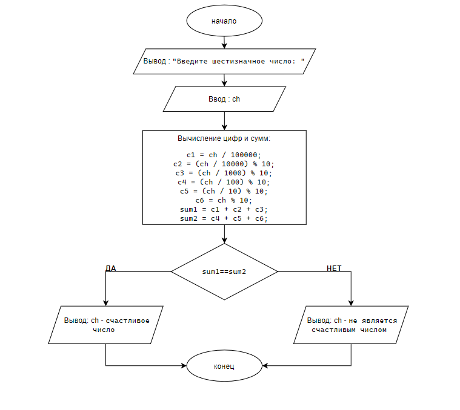

# Домашнее задание к lab6
### Вариант 8
### Задача
Дано шестизначное число, определить является ли оно "счастливым".

### Решение
```
#define _CRT_SECURE_NO_DEPRECATE
#include <locale.h>
#include <stdio.h>
int main()
{
	setlocale(LC_ALL, "ru_RU.UTF-8");
	int ch;
	puts("Введите шестизначное число: ");
	scanf("%d", &ch);
	int c1 = ch / 100000;
	int c2 = (ch / 10000) % 10;
	int c3 = (ch / 1000) % 10;
	int c4 = (ch / 100) % 10;
	int c5 = (ch / 10) % 10;
	int c6 = ch % 10;
	int sum1 = c1 + c2 + c3;
	int sum2 = c4 + c5 + c6;
	if ( sum1==sum2 )
	{
		printf("%d - счастливое число", ch);
	}
	else
	{
		printf("%d - не является счастливым числом", ch);
	}
 }
```
### Блок-схема

### Вывод
Программа определяет какие числа являются "счастливыми", а какие нет.
